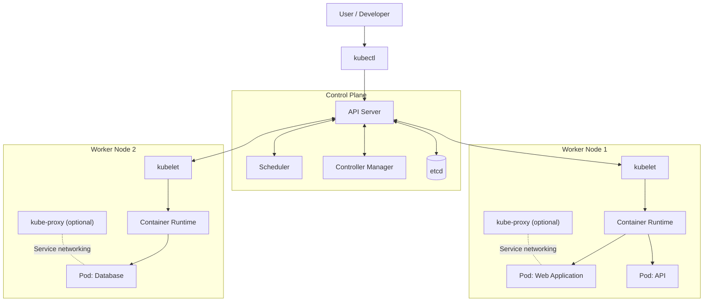

# Kubernetes-lerning


## **K8s (Kubernetes)**
  K8s (Kubernetes) is an open-source platform used to deploy, manage, and scale containerized applications automatically.
  In simple terms, Kubernetes helps you run applications reliably across multiple servers without having to manage every application manually.

## **Why do we need Kubernetes?**

  Imagine you have a web application running inside a Docker container.

  - What happens if the container crashes?
  - What if 10,000 users access your application at once?
  - How do you deploy a new version without downtime?
  - How do you manage hundreds of containers across multiple servers?
  - Kubernetes helps solve these problems automatically.

# Kubernetes Architecture

  Kubernetes (K8s) is a container orchestration platform that automates the deployment, scaling, and management of containerized applications.


Kubernetes architecture consists of two major parts:

- **Control Plane** — Manages the cluster and makes scheduling decisions.
- **Worker Nodes** — Run application workloads inside Pods.

## 2. Kubernetes Architecture Diagram



## 3. Control Plane Components

The control plane manages the overall state of the Kubernetes cluster.

### 3.1 API Server (`kube-apiserver`)

The API server is the entry point for Kubernetes API requests.

Responsibilities:
- Receives requests from `kubectl` and other components.
- Authenticates and authorizes requests.
- Validates Kubernetes resources.
- Provides the API used by other control-plane components.

Example:

```bash
kubectl get pods
kubectl get nodes
kubectl apply -f deployment.yaml
```

### 3.2 Scheduler (`kube-scheduler`)

The scheduler selects a suitable worker node for each newly created, unscheduled Pod.

It considers:
- Available CPU and memory.
- Pod resource requests.
- Node selectors and affinity rules.
- Taints and tolerations.
- Scheduling constraints.

The scheduler selects a node but does not directly start containers.

### 3.3 Controller Manager (`kube-controller-manager`)

The controller manager runs controllers that continuously reconcile actual cluster state with desired state.

Example:

If a Deployment requests three replicas but only two exist, the controllers work to restore the desired replica count.

Common controllers include:
- Deployment and ReplicaSet-related controllers.
- Node controller.
- Job controller.
- EndpointSlice controller.

### 3.4 etcd

etcd is a distributed key-value store used to persist Kubernetes cluster data.

It stores information such as:
- Kubernetes resource definitions and metadata.
- Cluster configuration.
- Resource state.

The API server accesses etcd; other components normally interact with cluster state through the API server.

## 4. Worker Node Components

Worker nodes run the Pods that host application workloads.

### 4.1 Kubelet

Kubelet is an agent that runs on each worker node.

Responsibilities:
- Obtains Pod specifications assigned to its node.
- Works with the container runtime to start and stop containers.
- Runs configured container health probes.
- Reports Pod and container status to the API server.
- Works to ensure assigned Pods match their specifications.

Kubelet does not schedule Pods across the cluster. The scheduler performs that task.

### 4.2 Container Runtime

The container runtime executes containers on the worker node.

Examples:
- containerd
- CRI-O

Kubelet communicates with the runtime through the Container Runtime Interface (CRI).

### 4.3 kube-proxy

kube-proxy implements Kubernetes Service networking rules on many clusters.

It helps route network traffic to appropriate backends.

Some cluster networking implementations replace kube-proxy, so it is not present in every cluster.

## 5. Pods

A Pod is the smallest deployable unit in Kubernetes.

A Pod contains one or more containers that share a network identity and can share storage volumes.

Example workloads:

- Frontend application.
- Backend API.
- Background worker.
- Database.

Pods are scheduled onto worker nodes and may be replaced when necessary.

## 6. How Kubernetes Works

Consider a Deployment requesting three replicas of an application.

1. The developer submits a Deployment manifest using `kubectl`.
2. The API server validates the request.
3. The desired resource state is persisted in etcd.
4. The Deployment controller creates or updates a ReplicaSet.
5. The ReplicaSet controller ensures that three Pods are requested.
6. The scheduler assigns unscheduled Pods to suitable worker nodes.
7. The kubelet on each selected node works with the container runtime to start containers.
8. Kubelet reports Pod status to the API server.
9. Controllers continue reconciling actual state with desired state.

This continuous reconciliation is a fundamental Kubernetes concept.

## 7. Example Deployment

Create a file named `deployment.yaml`:

```yaml
apiVersion: apps/v1
kind: Deployment
metadata:
  name: web-app
spec:
  replicas: 3
  selector:
    matchLabels:
      app: web-app
  template:
    metadata:
      labels:
        app: web-app
    spec:
      containers:
        - name: web
          image: nginx:stable
          ports:
            - containerPort: 80
```

Deploy the application:

```bash
kubectl apply -f deployment.yaml
```

Check the Deployment:

```bash
kubectl get deployments
```

Check the Pods and their assigned nodes:

```bash
kubectl get pods -o wide
```

Inspect the Deployment:

```bash
kubectl describe deployment web-app
```

## 8. Important kubectl Commands

```bash
# View cluster nodes
kubectl get nodes

# View Pods
kubectl get pods

# View Pods across all namespaces
kubectl get pods -A

# View Deployments
kubectl get deployments

# View Services
kubectl get services

# View cluster events
kubectl get events

# View Pod logs
kubectl logs <pod-name>

# Inspect a Pod
kubectl describe pod <pod-name>
```


